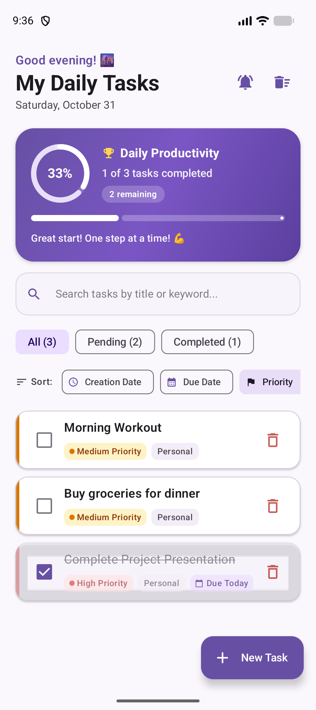
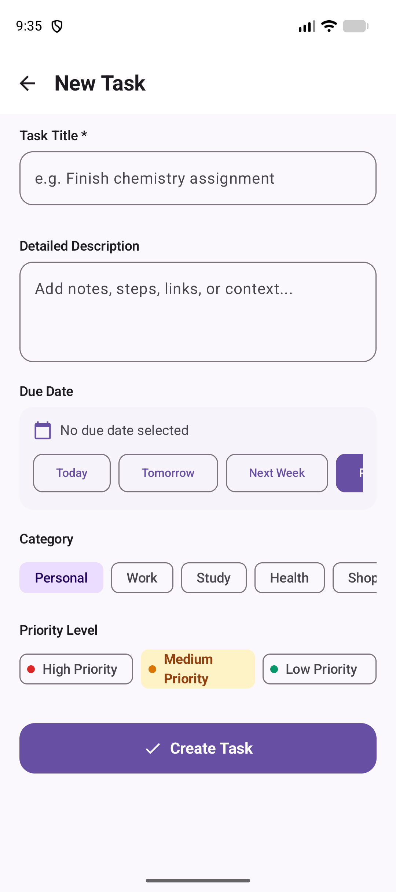
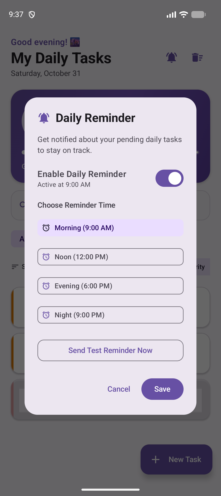

# Taskflow 🚀

A modern, intuitive Android task management & daily productivity app built with Kotlin, Jetpack Compose, Material Design 3, and Room Database.

### 📲 [Click Here to Download Taskflow-v1.0.apk](https://github.com/omsoni21/Taskflow/raw/main/Taskflow-v1.0.apk)

## ✨ Features
- 📝 **Task Management**: Create, edit, and delete daily tasks with priority levels (High, Medium, Low).
- 📊 **Productivity Tracking**: Visual progress indicators and daily status summary.
- 🔍 **Search & Filter**: Quickly search tasks by title or keyword, filter by status (All, Pending, Completed), and sort by creation date, due date, or priority.
- 🔔 **Daily Reminders**: Local notification scheduling for timely task alerts.
- 🎨 **Modern UI**: Clean and responsive layout built with Jetpack Compose and Material 3 design system.

## 📱 Screenshots

| Home Screen & Task List | Add New Task | Daily Reminder Settings |
| :---: | :---: | :---: |
|  |  |  |

## 🎥 App Demo & Video Walkthrough

> Watch Taskflow in action with full HD feature demonstration.

| 🎬 Interactive Web Demo (Appetize.io) | 📹 Watch Full Demo Video |
| :---: | :---: |
|  |  |

### 🎬 <a href="https://github.com/omsoni21/Taskflow/blob/main/screenshots/demo.mp4" target="_blank">▶️ Click Here to Watch Taskflow Demo Video in New Tab</a>

  <video src="https://github.com/omsoni21/Taskflow/blob/main/screenshots/demo.mp4" width="600" controls title="Taskflow Full App Demo" poster="https://raw.githubusercontent.com/omsoni21/Taskflow/main/screenshots/home_screen.png">
    Your browser does not support the video tag.
  </video>

*Note: Clicking the link above opens the full HD video online in a new browser tab without downloading.*

## 🛠️ Tech Stack
- **Language**: Kotlin
- **UI Framework**: Jetpack Compose & Material Design 3
- **Local Storage**: Room Persistence Library
- **Architecture**: MVVM (Model-View-ViewModel) with StateFlow
- **Concurrency**: Kotlin Coroutines & Flow
